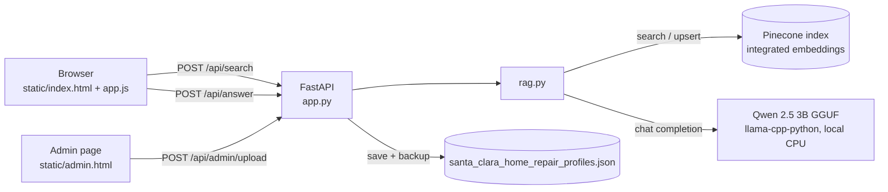
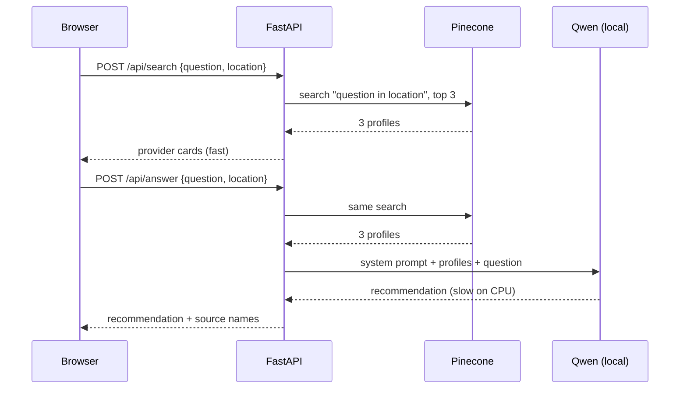

# Architecture

FixIT-Pro is a small retrieval-augmented generation (RAG) app: it **retrieves** the technician profiles most relevant to a request, then has a language model **generate** a recommendation from only those profiles.

## Components

| Component | File | Responsibility |
| --- | --- | --- |
| Web server | `app.py` | Serves pages and the JSON API, checks the admin password, validates upload size |
| RAG logic | `rag.py` | Connects to Pinecone, validates and upserts profiles, searches, generates answers |
| Landing page and results | `static/index.html`, `static/app.js` | Search form, provider cards, AI recommendation panel |
| Admin page | `static/admin.html` | Password sign-in, dashboard, optional profile upload |
| Styles | `static/styles.css` | Shared styles for both pages |
| Notebook | `home_repair_rag.ipynb` | The original step-by-step version of the same pipeline |

## How a search works

1. The location, if given, is appended to the question (`"<question> in <location>"`).
2. Pinecone embeds the query with the index's integrated model and returns the 3 closest profiles from the `santa-clara-technician-profiles` namespace.
3. The browser shows provider cards right away.
4. A second request asks Qwen for a recommendation. The model sees only the 3 retrieved profiles and a system prompt that tells it to use labeled fields, write "Not published" for missing values, keep caveats such as license conflicts, and never invent contact details, prices or licensing.

## Design decisions

- **Two requests instead of one.** Search takes about a second; a CPU-only answer can take a minute. Splitting them lets the cards appear immediately. The answer endpoint repeats the search rather than trusting profile text sent from the browser.
- **One model call at a time.** llama.cpp models aren't safe to call from several threads, so `rag.answer` holds a lock. Concurrent answer requests wait in line.
- **Lazy model loading.** Qwen loads on the first answer request, not at startup, so the server starts quickly and search works even if the model file is missing.
- **Stable document IDs.** Each profile is stored as `technician-<ID>`, so re-uploading updates existing documents instead of duplicating them.
- **Profile text as data.** Profiles are passed to the model as data, and the browser escapes all profile text before display. Links are only rendered for `http(s)` URLs.

## Data in Pinecone

Each profile becomes one Pinecone document:

| Field | Value |
| --- | --- |
| `_id` | `technician-<ID>` |
| `title` | The profile's `Name / company` |
| `chunk_text` | Every non-empty field as `Field: value` lines; this is the text Pinecone embeds |

Search results are turned back into fields by parsing those `Field: value` lines, which is how the cards show structured data.
