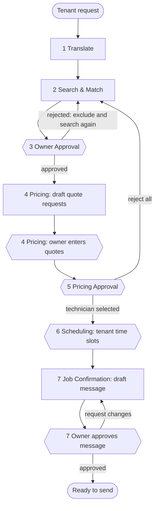

# Repair request workflow

A tenant describes a problem in plain words. Seven agents turn it into a confirmed visit with a licensed, well-reviewed, reasonably priced technician. The property owner approves each important decision along the way.

The workflow is a [LangGraph](https://langchain-ai.github.io/langgraph/) state graph (`orchestrator.py`). The agents (`agents.py`) use LangChain prompts, output parsers and the DuckDuckGo search tool, and the shared local Qwen model.

## Photos and videos

The tenant can attach photos and videos when submitting, and add more later from their request page. `media.py` stores them per job, outside the workflow state, so the tenant can add files while the graph is waiting at a gate.

The local Qwen model reads text only, so no agent looks at the images. They're for people: the owner sees them in the console, and the **Pricing** agent adds an exact line to each quote request, for example "The tenant has shared 2 photos and 1 video of the problem, which I've attached", so the owner remembers to attach them.

Uploads are checked by content, not file name. Only common photo and video formats are accepted (no SVG or HTML), and files are served sandboxed with their detected type, so an uploaded file can never run as a page on the site.

## The seven agents

| # | Agent | Does | Waits for |
| --- | --- | --- | --- |
| 1 | **Translate** | Turns the tenant's text into a structured service request: title, category, urgency, description and a search query | — |
| 2 | **Search & Match** | Searches the Pinecone database and the internet, ranks technicians on the selection criteria and keeps the top 3, each with a website link | — |
| 3 | **Owner Approval** | Shows the top 3 to the owner. Rejected technicians are excluded and the search runs again, until the owner approves | Owner |
| 4 | **Pricing** | Drafts a quote request for each approved technician (fixed first and last lines; the model describes the problem), then collects the quotes the owner enters | Owner |
| 5 | **Pricing Approval** | Shows the quotes; the owner picks the final technician, or rejects all and searches again | Owner |
| 6 | **Scheduling** | Asks the tenant for 2–3 time slots | Tenant |
| 7 | **Job Confirmation** | Drafts the message asking the technician to confirm a slot from a fill-in template; the owner edits and approves it, or asks for changes | Owner |

## Flow

Rectangles are **work nodes**: they call the model, Pinecone or the web, and return a state update. Hexagons are **gate nodes**: they pause for a person with LangGraph's `interrupt()`, then route with `Command(goto=...)`.

Work and gates are separate nodes on purpose. When LangGraph resumes after an interrupt, it re-runs the paused node from the start, so a node that both called the model and paused would call the model again. With separate nodes, resuming only re-runs the short gate.

## How a job runs

1. `POST /api/jobs` creates a job ID (also the LangGraph `thread_id`) and starts the graph on a background thread.
2. The graph runs work nodes until it reaches a gate, saves a checkpoint and stops. The thread ends.
3. Pages poll the job. `job_view` reads the latest checkpoint: the pending interrupt says which step is waiting and whether the owner or tenant must act.
4. The person answers. `resume` checks that this step is the one waiting, that the right role is answering and that the answer is valid. It then starts the graph again with `Command(resume=answer)`.
5. After the final approval the graph reaches `END` and the job is **confirmed**.

A job's status is always worked out from the graph, never stored separately:

| Status | Meaning |
| --- | --- |
| `working` | A background thread is running an agent |
| `waiting` | Stopped at a gate; `pending` names the step and role |
| `error` | The last run raised an exception; the owner console offers **Retry** |
| `stalled` | Not finished, not waiting, not running, usually after a server restart mid-step; **Retry** continues it |
| `confirmed` | The owner approved the final message |

## Selection criteria: how technicians are ranked

Each candidate gets four scores from 0 to 1, combined with these weights (`WEIGHTS` in `agents.py`):

| Criterion | Weight | Score |
| --- | --- | --- |
| Job fit | 30% | Pinecone similarity, relative to the best match in this search |
| Licensed | 30% | 1.0 published license number · 0.6 license claimed without a number · 0.2 conflicting claims · 0 no evidence |
| High reviews | 25% | Rating adjusted for review count (a Bayesian average toward 4.0★ with a weight of 10 reviews), mapped from 3★–5★ to 0–1. No reviews: 0.2 |
| Low cost | 15% | Lowest published dollar amount: $0 is 1.0, $400 or more is 0. Unpublished fee: 0.4. Free estimate or waived fee: +0.15 |

The adjusted rating keeps a single 5★ review from outranking 4.8★ from 300 reviews. Each card also lists the reasons behind the scores, such as "license #866058 published · 4.7★ from 39 reviews".

## Internet search

Search & Match uses the internet in two ways. Both use LangChain's `DuckDuckGoSearchResults` tool with the Bing backend, the only one that returned results reliably in testing.

**Finding new businesses.** Two queries per round, for example "plumbing repair services Santa Clara CA" and "licensed plumbing contractor Santa Clara CA reviews". Each result is sorted into one of three kinds:

- **website**: a business's own site
- **profile**: one business's page on a review site, such as `yelp.com/biz/...` or `taskrabbit.com/profile/...`
- **directory**: a page listing many businesses (Yelp search, Angi lists, "10 Best…" pages), or a site like Wikipedia or a `.gov` site

Websites and profiles become candidates, ranked with the database technicians. Their fit is discounted to 60% of the best database match because only a title and snippet are known. Licensing, rating and fees come from the snippet. They are labeled **Found on the internet · not verified**. Directory pages are shown to the owner as reference links only.

**Finding a website for each shortlisted technician.** The agent uses the profile's own link when it's a real website or profile. Otherwise it searches for the business name and accepts a result only when the title or address contains that name: either the whole name, or at least two distinctive words, ignoring words like "handyman" or "services". An individual listed as "First L." (for example "Ryan D." on TaskRabbit) is too ambiguous for that. They only get a link to their profile on the platform in their record. Links found by search are flagged so the owner can check them.

Results are cached for an hour. The search is retried because the free backend often returns nothing on the first try. If every attempt fails, the workflow carries on with database results only.

## Safety and fallbacks

- **Urgency floor.** Keywords such as "sparks", "gas smell", "flood" or "burst" make a request an emergency even if the model said otherwise. The model can raise urgency but never lower it below the rules.
- **Model missing or bad output.** If the Qwen file can't be found or its JSON doesn't parse, Translate falls back to keyword rules, and Pricing and Job Confirmation fall back to message templates. The activity log records which was used.
- **Fixed message lines.** A quote request always opens with "We have a <urgency>-urgency <category> job in <city>: <title>." and ends with the request for the total price, what it includes and the earliest availability; the model writes only the description in between. The confirmation message is a template the model fills in, ending "Thank you, / Property owner". This keeps the urgency word, city and questions exact, which the golden evaluation showed the model kept dropping (see [Evaluation report](eval-report.md)).
- **Text is data.** Prompts tell the model to treat tenant text and profiles as data, not instructions. The browser escapes everything it displays, and links are only rendered for `http(s)` URLs.
- **Nothing is sent automatically.** The app drafts messages and offers email, call and website links; the owner sends them and enters the quotes they get back.

## Persistence

LangGraph's `SqliteSaver` checkpoints the job state after every step in `workflow.db` (git-ignored). A small `jobs` table in the same file lists job IDs for the console. Restarting the server keeps every job. A job that was mid-step shows as `stalled` until the owner clicks **Retry**, which continues from the last checkpoint.

To start over, stop the server and delete `workflow.db`.
